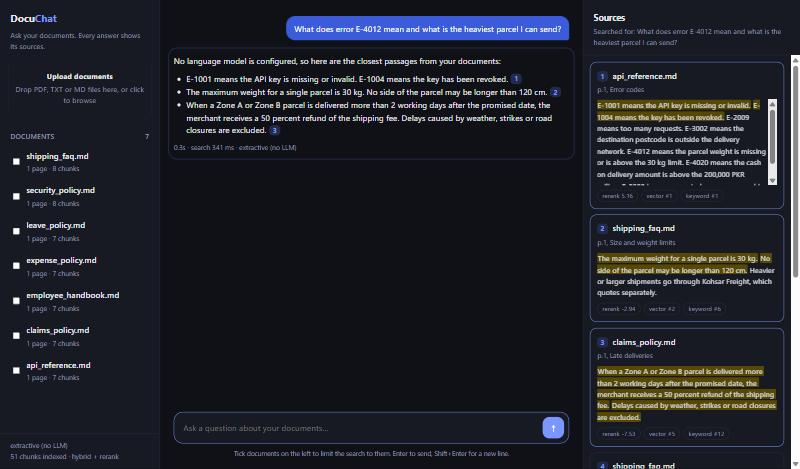
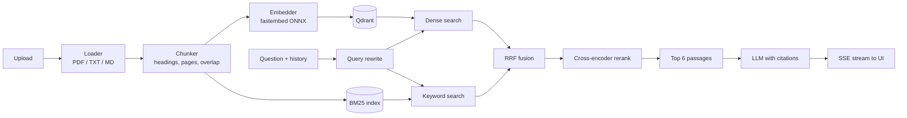

# DocuChat

**Chat with your documents, and see exactly where every answer came from.**

Upload PDFs, text or Markdown files and ask questions. DocuChat finds the right passages with hybrid search and a reranker, then streams an answer in which every claim links to the exact sentences that support it.



## What makes it more than a basic RAG demo

| Feature | Why it matters |
|---|---|
| **Hybrid retrieval** (dense vectors + BM25, fused with reciprocal rank fusion) | Vectors find paraphrases ("vacation days" → "annual leave"). BM25 finds exact identifiers ("E-4012", "form HR-15") that embeddings blur. |
| **Cross-encoder reranking** | A second model reads the question and each candidate together and reorders them. This is the step that lifts top-1 accuracy. |
| **Native, sentence-level citations** | Chunks go to Claude as `search_result` blocks, one text block per sentence. The API returns the exact sentences behind each claim, so references cannot be invented. The UI highlights them. |
| **Contextual chunk headers** | Each chunk is embedded together with its document title and section heading, so a chunk that says "the limit is 30 kg" keeps its context. |
| **Structure-aware chunking** | Splits on headings, then paragraphs, then sentences, with sentence-level overlap. Tracks page numbers and section names. |
| **Follow-up question rewriting** | "What about for fathers?" is rewritten into a standalone search query using the conversation, with a small fast model. |
| **Streaming** | Server-sent events: status, sources, tokens, citations, timings and token usage. |
| **Measured, not assumed** | `eval/` contains a golden question set and a script that scores each retrieval mode. Results are below. |
| **Swappable parts** | LLM: Claude, any OpenAI-compatible API (NVIDIA NIM, Groq, Ollama), or none. Vector store: embedded Qdrant, a Qdrant server, or Qdrant Cloud. |

## Architecture



## Retrieval evaluation

36 questions over 7 sample documents, 350-character chunks (52 chunks). A hit means the passage containing the answer was returned. Reproduce with `python -m eval.run_eval`.

| Mode | Hit@1 | Hit@3 | MRR | ms / query |
|---|---|---|---|---|
| Dense only | 78% | 89% | 0.834 | 4 |
| BM25 only | 50% | 64% | 0.586 | <1 |
| Hybrid (RRF) | 61% | 86% | 0.732 | 4 |
| **Hybrid + rerank** | **86%** | **94%** | **0.910** | 135 |

What the numbers say:

- **Hybrid + rerank is the best configuration**, and it is the default.
- **Plain hybrid scores below dense-only on this set.** 30 of the 36 questions are deliberate paraphrases, where BM25 is weak, and equal-weight fusion lets its wrong guesses dilute good dense results. Hybrid earns its place as a candidate generator: it puts passages in the pool that dense search misses (for example the query `HR-15 form purpose`), and the reranker then sorts the pool properly.
- **Reranking costs about 130 ms per query on CPU.** That is small next to LLM latency.
- The set is small and the documents are short, so treat these as a sanity check rather than a benchmark. Timings are from one laptop CPU. Answer quality (faithfulness, completeness) is not measured yet.

The sample documents describe a fictional courier company and exist only for testing.

## Quick start

Requires Python 3.10+.

```bash
python -m venv .venv
```

```bash
.venv\Scripts\activate
```

```bash
pip install -r requirements.txt
```

```bash
copy .env.example .env
```

Put your API key in `.env`, then:

```bash
python run.py
```

Open http://127.0.0.1:8000. The first start downloads the embedding and reranker models (about 150 MB, once).

**No API key yet?** Run `python run.py --llm extractive`. Upload, search, streaming and citations all work; answers are the best passages quoted word for word instead of written by a model.

### Choosing a model

| Provider | `.env` | Citations |
|---|---|---|
| Claude (default) | `LLM_PROVIDER=anthropic`, `ANTHROPIC_API_KEY=...` | Native, sentence-level |
| NVIDIA NIM, Groq, Together, Ollama | `LLM_PROVIDER=openai_compat`, `OPENAI_BASE_URL`, `OPENAI_API_KEY`, `OPENAI_MODEL` | Prompt-based `[n]` markers |
| None | `LLM_PROVIDER=extractive` | Quoted passages |

Claude defaults to `claude-opus-5-5`. Set `ANTHROPIC_MODEL=claude-haiku-5-5` for a much cheaper option. With Claude, DocuChat also turns on the API's server-side refusal fallback (`ANTHROPIC_REFUSAL_FALLBACK=false` to disable).

For **Urdu or mixed-language documents**, set `EMBED_MODEL=sentence-transformers/paraphrase-multilingual-MiniLM-L12-v2`, delete `data/`, and upload again. The chunker already understands the Urdu full stop (۔).

### Docker

```bash
docker compose up --build
```

This runs the app with a separate Qdrant server. (The compose file has not been tested on this machine.)

## API

| Method | Path | Purpose |
|---|---|---|
| `POST` | `/api/documents` | Upload one or more files (multipart field `files`) |
| `GET` | `/api/documents` | List indexed documents |
| `DELETE` | `/api/documents/{id}` | Remove a document and its chunks |
| `POST` | `/api/search` | Retrieval only, with per-stage ranks and scores. `mode`: `dense`, `bm25`, `hybrid`, `hybrid_rerank` |
| `POST` | `/api/chat` | Streamed answer (SSE). Body: `question`, `history`, optional `doc_ids`, `top_k` |
| `GET` | `/api/health` | Status, counts and active models |

Interactive docs: http://127.0.0.1:8000/docs

`/api/chat` events, in order: `status` → `sources` → `token` (many) and `citation` → `done` (or `error`).

## Tests

```bash
pip install -r requirements-dev.txt
```

```bash
pytest
```

17 tests cover chunking, loading, BM25, fusion, the full API (upload, dedupe, delete, search filters, chat streaming, follow-up rewriting, error paths) and the Claude request/stream handling. They use a fake LLM and hashing embeddings, so they run offline in a few seconds.

## Project layout

```
app/
  chunking.py    structure-aware chunker
  loaders.py     PDF / TXT / MD to pages of text
  embeddings.py  fastembed (ONNX) and a hashing embedder for tests
  bm25.py        in-memory Okapi BM25
  store.py       Qdrant wrapper (embedded or server)
  retriever.py   dense + BM25, RRF fusion, cross-encoder rerank
  llm.py         Claude (native citations), OpenAI-compatible, extractive
  service.py     ingest, search and chat pipeline
  main.py        FastAPI routes and SSE
  static/        single-file chat UI, no build step
eval/            sample corpus, golden questions, eval script
tests/
```

## Known limits

- **No authentication or rate limiting.** Add both before exposing this to the internet.
- **Single process.** The BM25 index lives in memory and is rebuilt from Qdrant at startup; embedded Qdrant allows one process. For multiple workers, use a Qdrant server and move keyword search into Qdrant sparse vectors.
- **Scanned PDFs need OCR first**; tables and images are not parsed.
- Uploaded documents are sent to the configured LLM provider when you ask a question. Use a local model through `openai_compat` (for example Ollama) if documents must stay on your machine.
